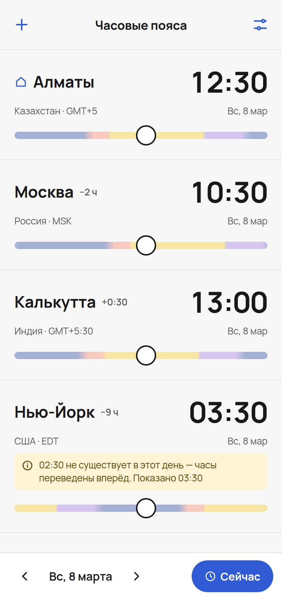
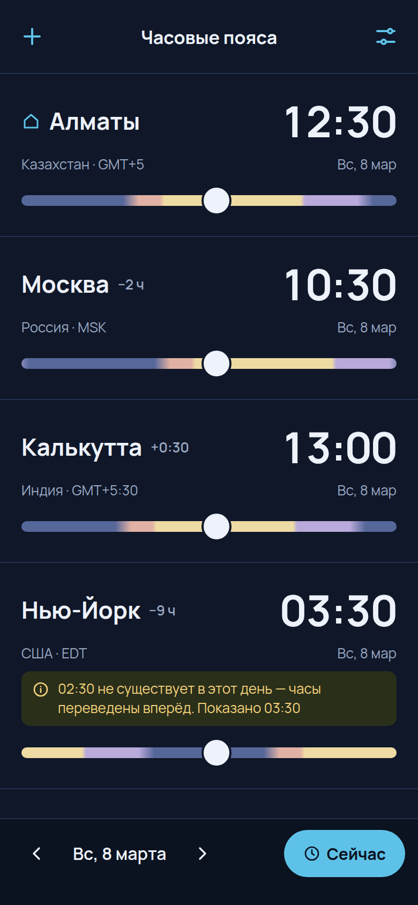
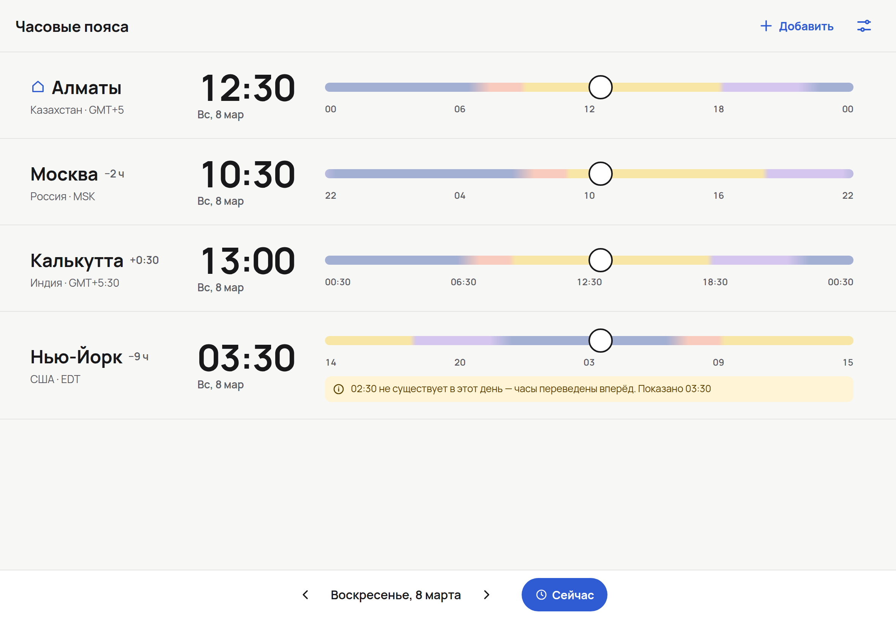
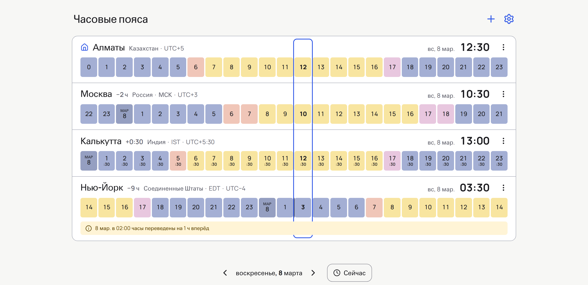
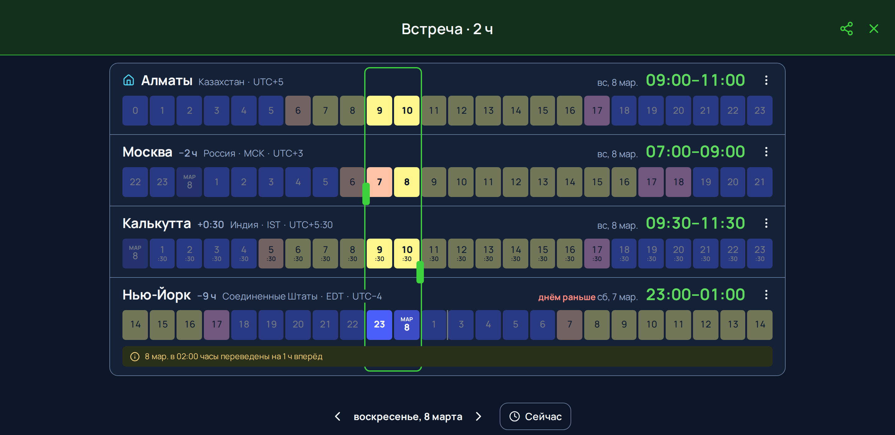

# Time Zones

[](LICENSE)

[](README.md)
[](README.ru.md)

Cross-device PWA for world clock, time zone conversion and meeting planning. Two views show the same list of places: the Cards view, one card per location with its time and day track, and the Grid view, hour cells aligned across all locations for choosing a meeting range. Client-only and offline-first — no account, no server, your data stays on your device.

**Live:** <https://oinsio.github.io/time-zones/> — installable to the home screen, works offline after the first visit.

## Contents

- [Features](#features)
- [Screenshots](#screenshots)
- [Localization](#localization)
- [Supported browsers](#supported-browsers)
- [Tech Stack](#tech-stack)
- [Development](#development)
- [Continuous integration and deployment](#continuous-integration-and-deployment)
- [Gnomish Factory](#gnomish-factory)
- [Contributing](#contributing)
- [License](#license)

## Features

Each group links the specs it summarizes; the specs in [`openspec/specs/`](openspec/specs/) are the source of truth.

- **Locations and search** — add places by city, country or time zone abbreviation (`EST`, `IST`), reorder them by dragging or with the keyboard, remove them. A location is stored by its IANA identifier (`"Europe/Moscow"`), never by a raw UTC offset, and the list is saved on the device. ([locations](openspec/specs/locations/spec.md), [location-search](openspec/specs/location-search/spec.md), [zone-abbreviations](openspec/specs/zone-abbreviations/spec.md))
- **Reading times** — the device time location always shows the time of your device, and the Here mark flags a location in the device zone. Mark one location as the home location and every other one shows its offset difference from it (`−2 h`, `+0:30`). The zone line shows country, zone abbreviation and UTC offset, and a note announces an upcoming clock change. ([home-location](openspec/specs/home-location/spec.md), [main-page](openspec/specs/main-page/spec.md))
- **Choosing a time and a date** — drag the handle on a day track or type a time in any location, and all others are recalculated. UTC offsets and daylight saving time are resolved for the selected date, not for today. ([time-selection](openspec/specs/time-selection/spec.md), [date-selection](openspec/specs/date-selection/spec.md))
- **Day periods and colouring** — night, morning, day and evening follow the sun at each location. Day tracks and hour cells are coloured plainly, by time of day or by your working hours. ([day-periods](openspec/specs/day-periods/spec.md), [day-colouring](openspec/specs/day-colouring/spec.md))
- **Grid view and meeting ranges** — pick a meeting range at any minute, see it in every location's local time and share it as text with Share meeting. ([grid-view](openspec/specs/grid-view/spec.md), [meeting-range](openspec/specs/meeting-range/spec.md))
- **Settings** — theme, hour format (12 or 24), view, day colouring and working hours, zone label parts and interface language. ([settings](openspec/specs/settings/spec.md), [app-shell](openspec/specs/app-shell/spec.md))
- **Offline work and updates** — installable PWA that works offline; new builds and new zone rules arrive silently, with a notice when zone rules change. ([app-delivery](openspec/specs/app-delivery/spec.md), [zone-rules-updates](openspec/specs/zone-rules-updates/spec.md))
- **Data and engines** — the app compiles its own IANA zone rules, uses GeoNames city data and runs on legacy iOS Safari. ([zone-rules](openspec/specs/zone-rules/spec.md), [city-data](openspec/specs/city-data/spec.md), [browser-compatibility](openspec/specs/browser-compatibility/spec.md))

## Screenshots

Cards view on phone and tablet, Grid view on desktop. Details: [docs/design](docs/design/README.md).

<table>
  <tr>
    <td align="center"></td>
    <td align="center"></td>
  </tr>
</table>







## Localization

Russian and English are built in; new languages need no code changes:

- **Auto-discovered locale files** — every `src/locales/<code>.json` is picked up automatically. Each file carries a `_meta` block (`code`, `name`, `nativeName`, `baseLanguage`, `emoji`); `_meta.code` must match the file name.
- **Adding a language** — drop a new locale file with a full set of keys; it appears in the language switcher of the settings page.
- **Dialects** — themed locales override only some keys of their `baseLanguage` and fall back to it, then to English, for everything else, including plural rules.
- **Choosing the language** — the interface language is the one picked on the settings page; without a choice the browser language is used (`en-US` → `en`), then English.

## Supported browsers

The latest Chrome, Firefox, Edge and Safari, and iOS Safari 12.5, the last release for iPhone 5s/6 and iPad Air / mini 2–3 ([ADR-0009](docs/adr/0009-supported-browser-engines.md)). Production syntax is lowered to the Safari 12 level, and CI checks the built files.

## Tech Stack

- React 18, TypeScript, Vite, Tailwind CSS, Radix UI, dnd-kit
- Temporal API (`temporal-polyfill`) for all date/time math, with the app's own compiled IANA zone rules ([ADR-0014](docs/adr/0014-zone-rules-from-iana.md))
- City data from GeoNames ([ADR-0015](docs/adr/0015-city-data-from-geonames.md))
- i18next + react-i18next
- PWA via `vite-plugin-pwa` (Workbox)
- Testing: Vitest, vitest-cucumber (BDD unit), playwright-bdd (BDD E2E), axe-core, Stryker (mutation)
- Lint and format: Biome

## Development

Requires Node.js >=26.0.0 (the exact major is in `.nvmrc`) and pnpm >=9.0.0.

The project's ubiquitous language — every domain term, the code that owns it and its Russian name — is defined in the [glossary](docs/glossary/README.md). Start there before changing domain code.

```bash
pnpm install
pnpm dev          # start dev server
pnpm build        # production build
pnpm --filter @time-zones/client preview   # serve the production build (with the service worker)
pnpm preflight    # lint + typecheck + tests
pnpm --filter @time-zones/client test:bdd  # BDD E2E suite
```

The app is served under `/time-zones/` in every mode, so open `http://localhost:<port>/time-zones/`. The base path is defined once in [`packages/client/app.config.ts`](packages/client/app.config.ts).

### Replacing the logo

All icons are generated during the build from one image. To change the logo, replace [`packages/client/assets/app-icon-source.png`](packages/client/assets/app-icon-source.png) with a square PNG with a transparent background (at least 512×512 px) and run `pnpm build`. Padding and background of the maskable and Apple icons are set in [`packages/client/pwa-assets.config.ts`](packages/client/pwa-assets.config.ts).

Features are developed with [OpenSpec](openspec/): `/opsx:propose` → `/opsx:apply` → `/opsx:archive`.

## Continuous integration and deployment

Six workflows live in [`.github/workflows/`](.github/workflows/):

- [`ci.yml`](.github/workflows/ci.yml) runs on every pull request. The `check` job runs lint, typecheck, unit tests, production build, data-only path, city data, zone rules and legacy build checks, the initial JS budget (150 KB gzipped), a check that the build left sources untouched, and the full BDD E2E suite. The non-blocking `benchmark` job reports benchmark budgets. The `preview` job deploys a PR preview.
- [`deploy.yml`](.github/workflows/deploy.yml) runs on every push to `main`: the same checks, then, only if they pass, a deploy to GitHub Pages. A failed check leaves the previous version live; rollback is a revert on `main`.
- [`zone-rules-publication.yml`](.github/workflows/zone-rules-publication.yml), [`city-data-refresh.yml`](.github/workflows/city-data-refresh.yml) and [`cldr-update.yml`](.github/workflows/cldr-update.yml) refresh zone rules, city data and CLDR data through pull requests; they work only while the repository variable `DATA_REFRESH_ENABLED` is `true`. Merged data reaches users as a silent update ([ADR-0017](docs/adr/0017-data-refresh-through-pull-requests.md), [ADR-0018](docs/adr/0018-silent-data-updates-and-the-app-revision.md)).
- [`cla.yml`](.github/workflows/cla.yml) checks that every contributor signed the CLA.

## Gnomish Factory

[Gnomish Factory](https://github.com/oinsio/gnomish-factory) runs AI agents ("gnomes") through a pipeline of declarative stages that live in this repository. Every stage ends in automated checks and, for most, an LLM judge; a stage that keeps failing escalates to a human instead of shipping. The setup lives in [`.gnomish/`](.gnomish/): `config.yaml` (tracker, attempt limit, labels), `pipeline.yaml` (stage order), `lib/` (shell helpers of the checks), `stages/<name>/` (executor, checks, brief and judge criteria) and `factory/` (what launches the factory). Setting up a machine, running and Docker: the [factory guide](docs/gnomish-factory/README.md).

The pipeline takes a task from an idea, or from a change already written on `main`, to a pull request in 10 stages. Every stage advances automatically; after the stage's attempt limit (the default is `autonomy.attemptLimit` (4), a stage may override it) the task escalates to a human.

| # | Stage | Model | Judge | Attempts | What the gnome does | Accepted when |
|---|-------|-------|-------|----------|---------------------|---------------|
| 1 | `specify` | `opus` | `opus` | 8 | picks the change the task names, or writes a new one with `/opsx:propose`; checks its dependencies; writes the change record | change record names an active change, strict validation, proposal sections and ids, judge |
| 2 | `review-specs` | `opus` | `opus` | 6 | reviews the change and writes findings to `review-specs.md` | report format, no other file touched, judge |
| 3 | `fix-specs` | `opus` | `opus` | 4 | fixes or rejects every finding with evidence | no `open` findings, nothing outside the change, judge |
| 4 | `implement` | `sonnet` | `opus` | 12 | implements the change in `packages/client` with TDD and ticks every task | all tasks ticked, 300-line cap, the CI steps, judge |
| 5 | `review-code` | `opus` | `opus` | 4 | reviews the implementation and writes findings to `review-code.md` | report format, no other file touched, judge |
| 6 | `fix-code` | `sonnet` | `opus` | 4 | fixes the findings worth fixing with TDD, rejects the rest | no `open` findings, the CI steps again, judge |
| 7 | `archive` | `sonnet` | `sonnet` | 4 | archives the change under `openspec/changes/archive/YYYY/MM/` and folds its deltas into `openspec/specs/` | change no longer active, strict spec validation, judge |
| 8 | `cleanup` | `claude-haiku-5-5` | — | 4 | removes the task's reports | the directory is gone, nothing else touched |
| 9 | `deliver` | `sonnet` | — | 4 | opens or updates a pull request to `main` | open PR with a real title and a body that matches `pr-body.md` |
| 10 | `usage-report` | `claude-haiku-5-5` | — | 4 | posts the task's agent time, check time and tokens as one pull request comment | the PR carries the marked `## Factory usage` comment |

**Where a task starts.** A task branch `gnomish/<task-id>` starts from the current `main`. The stages that diff the branch use the parent of its `gnomish: task started` commit as the base.

**Which change a task works on.** `openspec/changes/` may hold several active changes; only one is the task's. `specify` records it in `temporary-docs/gnomish/<task>/change.md` (`Change:` and `Verdict:` lines), and later stages read it from there. To run a change already on `main`, name it in the issue title or as a `Change: <name>` line in its body. `cleanup` removes the task's reports before the pull request.

**Handoff items.** Paths a stage may not write (`.github/`, `.claude/`, `.gnomish/`, `docs/adr/`, `openspec/specs/`) go to a handoff patch under `temporary-docs/gnomish/<task>/handoff/` and appear in the Human follow-up section of the pull request.

**Asking a human.** A stage that needs a decision writes a question with options to `$GNOMISH_DECISION_FILE`; the task gets the `gnomish:needs-human` label, and the answer comes back as a Decision. How to answer is in the factory's [operator guides](https://github.com/oinsio/gnomish-factory/tree/main/docs/guides).

## Contributing

Read [CONTRIBUTING.md](CONTRIBUTING.md) and sign the [CLA](CLA.md) before your first pull request.

## License

[Apache License 2.0](LICENSE)

City data: [GeoNames](https://www.geonames.org/), CC BY 4.0 ([details](packages/client/city-data/README.md))
