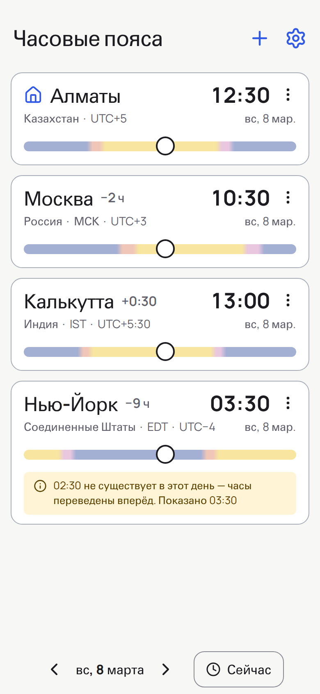
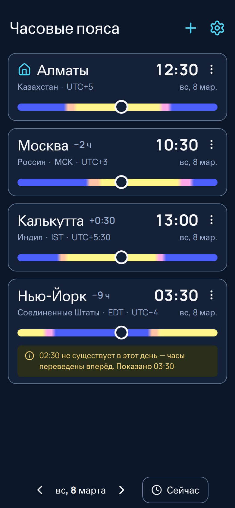
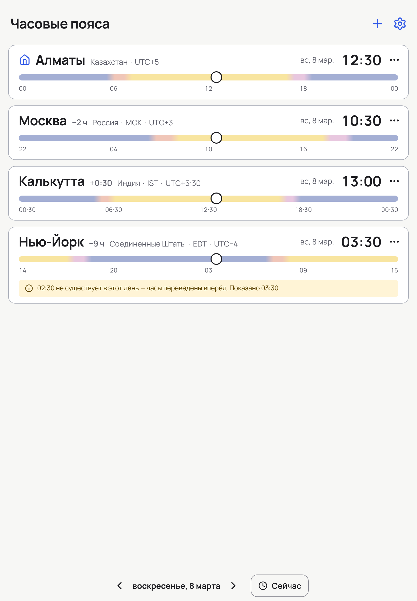
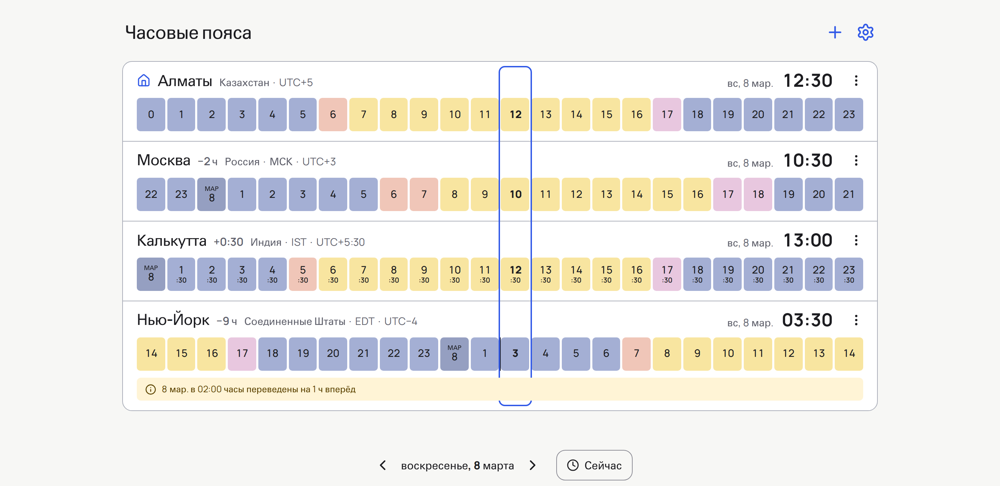
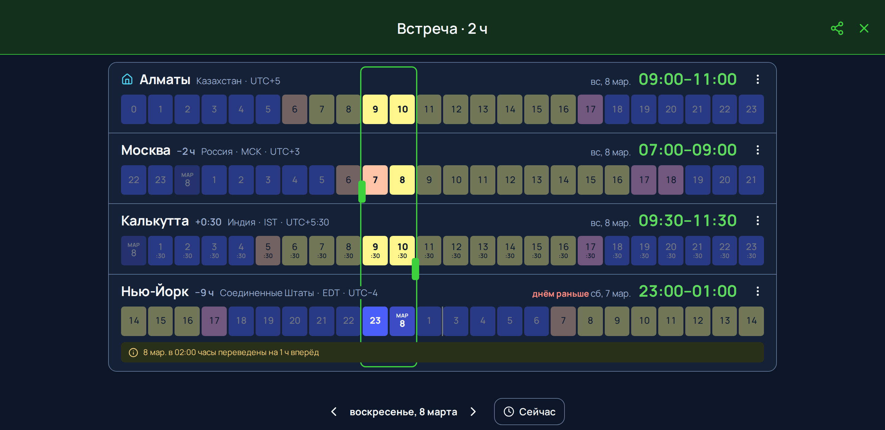

# Time Zones

[](LICENSE)

[](README.md)
[](README.ru.md)

Кроссплатформенное PWA для мировых часов, перевода времени между часовыми поясами и планирования встреч. Два вида показывают один и тот же список мест: «Карточки» — по карточке на место с временем и шкалой дня, и «Сетка» — часовые ячейки, выровненные по всем местам, для выбора времени встречи. Только клиент, offline-first — без аккаунта и сервера, данные остаются на устройстве.

**Приложение:** <https://oinsio.github.io/time-zones/> — устанавливается на домашний экран, после первого визита работает офлайн.

## Содержание

- [Возможности](#возможности)
- [Скриншоты](#скриншоты)
- [Локализация](#локализация)
- [Поддерживаемые браузеры](#поддерживаемые-браузеры)
- [Технологии](#технологии)
- [Разработка](#разработка)
- [CI и деплой](#ci-и-деплой)
- [Гномская фабрика](#гномская-фабрика)
- [Участие в разработке](#участие-в-разработке)
- [Лицензия](#лицензия)

## Возможности

Каждая группа ссылается на спецификации, которые кратко пересказывает; источник истины — спецификации в [`openspec/specs/`](openspec/specs/).

- **Места и поиск** — добавление мест через поиск по городу, стране или аббревиатуре часового пояса (`EST`, `IST`), перемещение перетаскиванием или с клавиатуры, удаление. Место хранится по IANA-идентификатору (`"Europe/Moscow"`), а не по «сырому» смещению от UTC, список сохраняется на устройстве. ([locations](openspec/specs/locations/spec.md), [location-search](openspec/specs/location-search/spec.md), [zone-abbreviations](openspec/specs/zone-abbreviations/spec.md))
- **Чтение времени** — «Время устройства» всегда показывает время вашего устройства, а отметка «Вы здесь» помечает место в поясе устройства. Одно место можно сделать домашним, и у остальных показывается разница смещений с ним (`−2 ч`, `+0:30`). Строка пояса показывает страну, аббревиатуру и смещение UTC, а заметка предупреждает о скорой смене часов. ([home-location](openspec/specs/home-location/spec.md), [main-page](openspec/specs/main-page/spec.md))
- **Выбор времени и даты** — потяните ручку на шкале дня или введите время в любом месте, остальные пересчитаются. Смещения от UTC и летнее время вычисляются для выбранной даты, а не для сегодняшней. ([time-selection](openspec/specs/time-selection/spec.md), [date-selection](openspec/specs/date-selection/spec.md))
- **Периоды суток и раскраска** — ночь, утро, день и вечер определяются по солнцу в каждом месте. Шкалы дня и ячейки раскрашиваются обычно, по времени суток или по вашим рабочим часам. ([day-periods](openspec/specs/day-periods/spec.md), [day-colouring](openspec/specs/day-colouring/spec.md))
- **«Сетка» и встречи** — выберите встречу с точностью до минуты, увидьте её в местном времени каждого места и поделитесь ею текстом через «Поделиться встречей». ([grid-view](openspec/specs/grid-view/spec.md), [meeting-range](openspec/specs/meeting-range/spec.md), [meeting-share-dialog](openspec/specs/meeting-share-dialog/spec.md))
- **Настройки** — тема, формат времени (12 или 24 часа), вид, раскраска и рабочие часы, обозначение часового пояса и язык интерфейса. ([settings](openspec/specs/settings/spec.md), [app-shell](openspec/specs/app-shell/spec.md))
- **Офлайн и обновления** — устанавливаемое PWA, работающее офлайн; новая версия приложения показывает уведомление с кнопкой «Обновить» (само приложение не перезагружается), а обновления только данных (правила поясов, данные о городах) приходят тихо; уведомление о правилах часовых поясов появляется, только если новый выпуск меняет отслеживаемый пояс. ([app-delivery](openspec/specs/app-delivery/spec.md), [zone-rules-updates](openspec/specs/zone-rules-updates/spec.md))
- **Данные и движки** — приложение компилирует собственные правила часовых поясов IANA, использует данные о городах GeoNames и работает на старом iOS Safari. ([zone-rules](openspec/specs/zone-rules/spec.md), [city-data](openspec/specs/city-data/spec.md), [browser-compatibility](openspec/specs/browser-compatibility/spec.md))

## Скриншоты

«Карточки» на телефоне и планшете, «Сетка» на десктопе. Подробности: [docs/design](docs/design/README.md).

<table>
  <tr>
    <td align="center"></td>
    <td align="center"></td>
  </tr>
</table>







## Локализация

Русский и английский встроены; новые языки добавляются без изменения кода:

- **Автообнаружение файлов локалей** — каждый `src/locales/<code>.json` подхватывается автоматически. В каждом файле есть блок `_meta` (`code`, `name`, `nativeName`, `baseLanguage`, `emoji`); `_meta.code` должен совпадать с именем файла.
- **Добавление языка** — положите новый файл локали с полным набором ключей; язык появится в переключателе на странице настроек.
- **Диалекты** — тематические локали переопределяют только часть ключей своего `baseLanguage`, а остальное, включая правила множественного числа, берут из него, затем из английского.
- **Выбор языка** — язык интерфейса — тот, что выбран на странице настроек; без выбора используется язык браузера (`en-US` → `en`), затем английский.

## Поддерживаемые браузеры

Последние Chrome, Firefox, Edge и Safari, а также iOS Safari 12.5 — последний выпуск для iPhone 5s/6 и iPad Air / mini 2–3 ([ADR-0009](docs/adr/0009-supported-browser-engines.md)). Синтаксис production-сборки понижается до уровня Safari 12, а CI проверяет собранные файлы.

## Технологии

- React 18, TypeScript, Vite, Tailwind CSS, Radix UI, dnd-kit
- Temporal API (`temporal-polyfill`) для всей работы с датой и временем, с собственными скомпилированными правилами поясов IANA ([ADR-0014](docs/adr/0014-zone-rules-from-iana.md))
- Данные о городах GeoNames ([ADR-0015](docs/adr/0015-city-data-from-geonames.md))
- i18next + react-i18next
- PWA через `vite-plugin-pwa` (Workbox)
- Тесты: Vitest, vitest-cucumber (BDD unit), playwright-bdd (BDD E2E), axe-core, Stryker (мутации)
- Линтер и форматирование: Biome

## Разработка

Нужны Node.js >=26.0.0 (точная мажорная версия — в `.nvmrc`) и pnpm >=9.0.0.

Единый язык проекта — каждый термин предметной области, владеющий им код и его русское название — описан в [глоссарии](docs/glossary/README.md). Начинайте с него, прежде чем менять доменный код.

```bash
pnpm install
pnpm dev          # dev-сервер
pnpm build        # production-сборка
pnpm --filter @time-zones/client preview   # отдать production-сборку (с service worker)
pnpm preflight    # lint + typecheck + тесты
pnpm --filter @time-zones/client test:bdd  # набор BDD E2E
```

Приложение отдаётся под `/time-zones/` в любом режиме, поэтому открывайте `http://localhost:<port>/time-zones/`. Базовый путь задан один раз в [`packages/client/app.config.ts`](packages/client/app.config.ts).

### Замена логотипа

Все иконки генерируются при сборке из одного изображения. Чтобы сменить логотип, замените [`packages/client/assets/app-icon-source.png`](packages/client/assets/app-icon-source.png) квадратным PNG с прозрачным фоном (не меньше 512×512 px) и выполните `pnpm build`. Отступы и фон maskable- и Apple-иконок заданы в [`packages/client/pwa-assets.config.ts`](packages/client/pwa-assets.config.ts).

Функции разрабатываются через [OpenSpec](openspec/): `/opsx:propose` → `/opsx:apply` → `/opsx:archive`.

## CI и деплой

В [`.github/workflows/`](.github/workflows/) лежат шесть workflow:

- [`ci.yml`](.github/workflows/ci.yml) запускается на каждый pull request. Задача `check` выполняет lint, typecheck, unit-тесты, production-сборку, проверки data-only путей, данных о городах, правил поясов и legacy-сборки, бюджет начального JS (150 KB gzip), проверку, что сборка не изменила исходники, и полный набор BDD E2E. Неблокирующая задача `benchmark` сообщает о бюджетах бенчмарков. Задача `preview` выкладывает превью PR.
- [`deploy.yml`](.github/workflows/deploy.yml) запускается на каждый push в `main`: те же проверки и, только если они прошли, деплой на GitHub Pages. Упавшая проверка оставляет в работе предыдущую версию; откат — это revert в `main`.
- [`zone-rules-publication.yml`](.github/workflows/zone-rules-publication.yml), [`city-data-refresh.yml`](.github/workflows/city-data-refresh.yml) и [`cldr-update.yml`](.github/workflows/cldr-update.yml) обновляют правила поясов, данные о городах и данные CLDR через pull request; они работают, только пока переменная репозитория `DATA_REFRESH_ENABLED` равна `true`. Влитые данные доходят до пользователей тихим обновлением ([ADR-0017](docs/adr/0017-data-refresh-through-pull-requests.md), [ADR-0018](docs/adr/0018-silent-data-updates-and-the-app-revision.md)).
- [`cla.yml`](.github/workflows/cla.yml) проверяет, что каждый участник подписал CLA.

## Гномская фабрика

[Gnomish Factory](https://github.com/oinsio/gnomish-factory) прогоняет ИИ-агентов («гномов») через конвейер декларативных стадий, которые лежат в этом репозитории. Каждая стадия завершается автоматическими проверками и, у большинства, LLM-судьёй; стадия, которая раз за разом не проходит, передаётся человеку, а не выпускается. Настройка лежит в [`.gnomish/`](.gnomish/): `config.yaml` (трекер, лимит попыток, метки), `pipeline.yaml` (порядок стадий), `lib/` (shell-помощники проверок), `stages/<name>/` (исполнитель, проверки, задание и критерии судьи) и `factory/` (всё, что запускает фабрику). Настройка машины, запуск и Docker: [руководство по фабрике](docs/gnomish-factory/README.ru.md).

Конвейер ведёт задачу от идеи, или от change, уже написанного в `main`, до pull request за 10 стадий. Каждая стадия переходит к следующей автоматически; после лимита попыток стадии (по умолчанию `autonomy.attemptLimit` (4), стадия может его переопределить) задача передаётся человеку.

| # | Стадия | Модель | Судья | Попытки | Что делает гном | Принимается, когда |
|---|--------|--------|-------|---------|-----------------|--------------------|
| 1 | `specify` | `opus` | `opus` | 8 | берёт change, названный в задаче, или пишет новый через `/opsx:propose`; проверяет его зависимости; пишет запись о change | запись о change называет активный change, строгая валидация, разделы и id proposal, судья |
| 2 | `review-specs` | `opus` | `opus` | 6 | проверяет change и пишет замечания в `review-specs.md` | формат отчёта, другие файлы не тронуты, судья |
| 3 | `fix-specs` | `opus` | `opus` | 4 | исправляет или обоснованно отклоняет каждое замечание | нет замечаний в `open`, ничего вне change, судья |
| 4 | `implement` | `sonnet` | `opus` | 12 | реализует change в `packages/client` по TDD и отмечает все задачи | все задачи отмечены, лимит 300 строк, шаги CI, судья |
| 5 | `review-code` | `opus` | `opus` | 4 | проверяет реализацию и пишет замечания в `review-code.md` | формат отчёта, другие файлы не тронуты, судья |
| 6 | `fix-code` | `sonnet` | `opus` | 4 | исправляет по TDD замечания, которые стоит исправить, остальные отклоняет | нет замечаний в `open`, снова шаги CI, судья |
| 7 | `archive` | `sonnet` | `sonnet` | 4 | архивирует change в `openspec/changes/archive/YYYY/MM/` и вливает его дельты в `openspec/specs/` | change больше не активен, строгая валидация спецификаций, судья |
| 8 | `cleanup` | `claude-haiku-5-5` | — | 4 | удаляет отчёты задачи | каталога больше нет, больше ничего не тронуто |
| 9 | `deliver` | `sonnet` | — | 4 | открывает или обновляет pull request в `main` | открыт PR с осмысленным заголовком и описанием, совпадающим с `pr-body.md` |
| 10 | `usage-report` | `claude-haiku-5-5` | — | 4 | публикует время агента, время проверок и токены задачи одним комментарием в pull request | в PR есть помеченный комментарий `## Factory usage` |

**Откуда стартует задача.** Ветка задачи `gnomish/<task-id>` начинается от текущей `main`. Стадии, которые сравнивают ветку, берут базой родителя её коммита `gnomish: task started`.

**Над каким change работает задача.** В `openspec/changes/` может лежать несколько активных change, задаче принадлежит один. `specify` записывает его в `temporary-docs/gnomish/<task>/change.md` (строки `Change:` и `Verdict:`), следующие стадии читают его оттуда. Чтобы запустить change, уже лежащий в `main`, назовите его в заголовке issue или строкой `Change: <name>` в описании. `cleanup` удаляет отчёты задачи до pull request.

**Handoff-пункты.** Стадия implement никогда не пишет в `.github/`, `.claude/`, `docs/adr/`, `CLAUDE.md`, `.gnomish/` и в `openspec/` — кроме чекбоксов `tasks.md`. Change, которому нужен один из этих путей, планирует его как handoff-пункт: патч и раздел README в `temporary-docs/gnomish/<task>/handoff/`, они появляются в разделе Human follow-up pull request. У пункта без изменения файла есть раздел README и нет патча.

**Вопрос человеку.** Стадия, которой нужно решение, пишет вопрос с вариантами в `$GNOMISH_DECISION_FILE`; задача получает метку `gnomish:needs-human`, а ответ возвращается как Decision. Как отвечать — в [руководствах оператора](https://github.com/oinsio/gnomish-factory/tree/main/docs/guides) фабрики.

## Участие в разработке

Прочтите [CONTRIBUTING.md](CONTRIBUTING.md) и подпишите [CLA](CLA.md) до первого pull request.

## Лицензия

[Apache License 2.0](LICENSE)

Данные о городах: [GeoNames](https://www.geonames.org/), CC BY 4.0 ([подробнее](packages/client/city-data/README.md))
